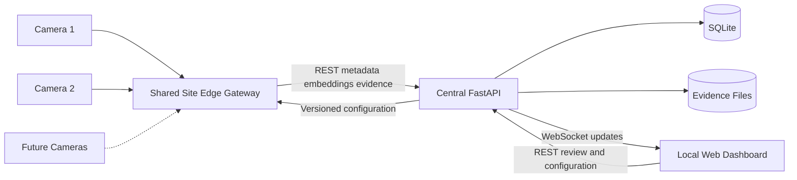

# AI Based Smart Surveillance System Architecture

## 1. Document Status

| Item | Value |
|---|---|
| Status | Approved architecture for the three-week Functional MVP |
| Last updated | 2026-10-17 |
| Primary deployment target | MSI development laptop running two camera streams |
| Architecture style | Shared Site Edge Gateway with a Central Server |
| Primary users | Surveillance operator and project evaluator |

เอกสารนี้กำหนดสถาปัตยกรรมเป้าหมายของโครงงาน **ระบบเฝ้าระวังพื้นที่อัจฉริยะโดยใช้ปัญญาประดิษฐ์** โดยปรับจากโปรแกรม Edge แยกต่อกล้องมาเป็น Shared Site Edge Gateway ที่ใช้ทรัพยากรร่วมกัน และ Central Server ที่รับผิดชอบการเชื่อมโยงเหตุการณ์ ตัวตน ฐานข้อมูล และ Dashboard

เป้าหมายระยะปัจจุบันคือ Functional MVP ที่สาธิตสองกล้องบน MSI laptop ได้ภายในสามสัปดาห์ พร้อมผลประเมินด้าน ML ประสิทธิภาพ และภาระงานของเจ้าหน้าที่ เอกสารนี้ไม่ถือว่าระบบพร้อมใช้งานจริงในสภาพแวดล้อม production

คำศัพท์หลักของโครงการอ้างอิงจาก [CONTEXT.md](./CONTEXT.md) โดยเอกสารนี้ปรับคำว่า Watchlist เป็น **Face Registry** เพื่อให้ตรงกับวัตถุประสงค์การจดจำพนักงานหรือบุคคลที่ลงทะเบียน

## 2. Current State and Problems

> หมายเหตุ: หัวข้อนี้บันทึกปัญหาของระบบต้นแบบเดิมที่นำไปสู่สถาปัตยกรรมนี้ สถานะการพัฒนาปัจจุบันดู §2.1

### 2.1 Implementation Status (2026-10-17)

| Capability | Status | Location |
|---|---|---|
| Shared Gateway สองแหล่ง, YOLO หนึ่ง instance, ByteTrack ต่อกล้อง | Implemented (ไฟล์วิดีโอและ synthetic) | `edge/run_gateway.py`, `edge/shared_gateway.py`, `edge/detection.py` |
| Event schema พร้อม `schema_version`, `event_id` idempotency | Implemented | `common/schemas.py`, `server/database.py` |
| Action Classifier 32-frame window + temporal rule 2/3 + scheduler 8 tracks | Implemented; threshold 0.70 ยังไม่ calibrate | `edge/action_runtime.py`, `edge/action_pipeline.py`, `configs/action_runtime.yaml` |
| InferenceROI, RestrictedZone, Tripwire | Implemented | `edge/spatial.py`, `configs/spatial_rules.yaml`, `tools/spatial_drawer.py` |
| Face Registry, Access Permission, Face-Zone Candidate | Implemented; threshold 0.55 ยังไม่ผ่าน open-set validation | `edge/face_pipeline.py`, `server/database.py`, `tools/enroll_face.py` |
| Evidence keyframe + person crop | Implemented | `edge/evidence.py`, `server/evidence_store.py` |
| Camera Topology, Global Person ID (120s), Association | Implemented; ใช้ face similarity + topology เท่านั้น | `server/association.py` |
| Incident correlation, Alert Policy, cooldown dedup | Implemented (API) | `server/alert_policy.py`, `server/app.py` |
| Human Review (Acknowledge/Confirm/Reject/Reclassify) | Implemented (API + Dashboard) | `server/app.py`, `server/static/index.html` |
| Person ReID | Not started | — |
| WebSocket push | Not started; Dashboard ใช้ REST polling | — |
| Evidence clip 3s/5s, RAM ring buffer, retention | Not started | — |
| RTSP/USB ingestion ใน Gateway | Not started | — |
| Zone Editor, Face Registry, Policy Editor, Topology UI บนเว็บ | Not started; ใช้ REST API หรือ CLI แทน | — |
| Camera Topology direction field | ยังไม่มี field แยก; edge มีทิศจาก source ไป destination | `common/identity_schemas.py` |

`main.py` และ `main_cam2.py` เป็น legacy per-camera prototype ที่ยังใช้ Risk Assessment และ Heatmap ซึ่งอยู่นอก MVP

### 2.2 Original Problems

ระบบต้นแบบเดิมรันกล้องสองตัวด้วยโปรแกรมแยกกัน ได้แก่ `main.py` และ `main_cam2.py` แต่ละโปรแกรมโหลด YOLO, SCRFD, ArcFace และ EfficientNet-B0 + GRU ของตนเอง ทำให้ใช้ GPU, VRAM และหน่วยความจำซ้ำ แม้ว่าจะรันบนเครื่องเดียวกัน

ปัญหาหลักที่ตรวจพบมีดังนี้

- ยังไม่มี Shared Gateway, supervisor หรือ inference scheduler สำหรับหลายกล้อง
- Central Server, REST API, WebSocket และ Dashboard ยังไม่มี implementation ที่สมบูรณ์
- Event payload ยังไม่มี schema version, sequence, idempotency key, model version และ evidence contract ที่เพียงพอ
- Action Classifier ประมวลผลลำดับภาพบุคคลจำนวนมากต่อ track และเป็นภาระหลักของ pipeline
- Runtime เดิมสามารถนำเฟรมจำนวนน้อยมาทำซ้ำให้ครบ 32 เฟรม ซึ่งไม่ตรงกับ temporal evidence ที่โมเดลควรได้รับ
- Action evaluation เดิมวัดด้วย argmax แต่ runtime ใช้ confidence threshold 0.70 จึงต้องทำ threshold validation ให้ตรงกัน
- Face evaluation เดิมรายงาน closed-set Top-1 accuracy แต่ยังไม่เพียงพอสำหรับยืนยันความสามารถแยกบุคคล Unknown
- Face threshold ในเอกสารและ runtime ไม่ตรงกัน จึงต้องเลือกค่าจากการทดลองเดียวกัน
- Heatmap แบบ 32 x 32 ไม่มีรายละเอียดเพียงพอสำหรับใช้อธิบายเหตุการณ์จริง และเพิ่มขนาด payload โดยไม่คุ้มค่า
- Risk Assessment MLP ใช้ input บางส่วนที่เลิกใช้แล้ว และยังไม่มี incident-level labels จากการตรวจทานของเจ้าหน้าที่ที่น่าเชื่อถือ
- Local Track ID ใช้ได้เฉพาะภายในกล้องและไม่สามารถระบุบุคคลข้ามกล้องได้
- Resource limit configuration เดิมยังไม่ถูกนำมาใช้ควบคุม runtime อย่างแท้จริง

## 3. Project Objectives

Functional MVP ต้องแสดงความสามารถต่อไปนี้

1. รับวิดีโอสองแหล่งพร้อมกันจาก RTSP, USB camera หรือไฟล์วิดีโอ
2. ตรวจจับและติดตามบุคคลด้วย Shared Gateway โดยไม่โหลดโมเดลซ้ำต่อกล้อง
3. ตรวจจับเหตุการณ์จาก Action Classifier และ spatial rules
4. จดจำบุคคลที่ลงทะเบียนใน Face Registry และแยกจากบุคคล Unknown
5. เชื่อมบุคคลเดียวกันระหว่างกล้องด้วย Face, Person ReID, เวลา และ Camera Topology
6. ระบุกล้อง เวลา พื้นที่ บุคคล และหลักฐานที่เกี่ยวข้องกับเหตุการณ์
7. แจ้ง Alert อัตโนมัติพร้อม Evidence Package โดยไม่ต้องรอเจ้าหน้าที่ยืนยันก่อน
8. ลดภาระเจ้าหน้าที่จากการเฝ้าวิดีโอต่อเนื่องให้เหลือการตรวจ Alert ที่ผ่านการคัดกรองและรวมเหตุการณ์ซ้ำแล้ว
9. ให้เจ้าหน้าที่วาด InferenceROI, RestrictedZone และ Tripwire แยกกัน
10. ให้เจ้าหน้าที่ปรับ Operational Alert Policy โดยไม่เปลี่ยน ML thresholds
11. เก็บผล Acknowledge, Confirm, Reject และ Reclassify สำหรับประเมินระบบและสร้าง dataset ในอนาคต
12. แสดง benchmark ที่ตรวจสอบได้บน MSI laptop และออกแบบ interface ให้ขยายจำนวนกล้องในอนาคตได้

## 4. Academic Contributions

คุณค่าด้าน AI ของโครงงานไม่ได้วัดจากจำนวน neural networks แต่จากการออกแบบ การทดลอง และการปรับใช้โมเดลให้ทำงานร่วมกันภายใต้ข้อจำกัดจริง

### 4.1 Temporal Action Recognition

- ใช้ EfficientNet-B0 เป็น spatial feature extractor และ GRU เป็น temporal classifier
- จำแนก `Normal`, `Property Crime` และ `Person Violence`
- ทำ preprocessing และ temporal window ตอนใช้งานให้ตรงกับตอนฝึก
- ประเมิน precision, recall, macro-F1, confusion matrix และ probability calibration
- ใช้ abstention เมื่อหลักฐานไม่เพียงพอ แทนการบังคับให้ผล confidence ต่ำเป็น Normal

### 4.2 Multimodal Cross Camera Association

เปรียบเทียบแบบ ablation ดังนี้

1. Face similarity เท่านั้น
2. Face similarity ร่วมกับ Person ReID
3. Face similarity ร่วมกับ Person ReID และ Camera Topology

ผลการทดลองต้องรายงาน correct association, false merge, ambiguous rate และ association latency โดยแยกกรณีเห็นหน้าและไม่เห็นหน้า

### 4.3 Resource Aware Distributed AI

- เปรียบเทียบโปรแกรม Edge แยกต่อกล้องกับ Shared Site Edge Gateway
- วัด FPS, p50/p95 latency, CPU, RAM, VRAM, dropped frames และจำนวน active action tracks ที่รองรับ
- เปรียบเทียบ YOLOv8n, YOLO11n และ YOLO26n บน input เดียวกัน
- ใช้ YOLO26n เป็นโมเดลหลักในการทดลอง แต่เลือกใช้งานสุดท้ายจากคุณภาพและ SLO ไม่ใช่เลขเวอร์ชัน

## 5. Scope

### 5.1 In Scope

- สอง camera streams บน MSI laptop
- Shared YOLO detector และ per-camera ByteTrack state
- EfficientNet-B0 + GRU action classification
- Face Registry ด้วย SCRFD และ ArcFace
- Lightweight Person ReID จาก quality keyframes
- Anonymous Global Person ID แบบ session-scoped
- InferenceROI, RestrictedZone และ Tripwire
- Typed Event Candidates และ explainable Rule Engine
- FastAPI REST API และ WebSocket สำหรับ Dashboard
- SQLite เป็น persistent store หลัก
- Evidence Package และ retention policy
- Local Web Dashboard, Zone Editor, Face Registry, Alert Policy Editor และ Camera Topology form
- Human review และ anonymized structured review records
- Functional, ML, performance และ workload-reduction evaluation

### 5.2 Out of Scope for the MVP

- Compressed heatmap
- Risk Assessment MLP ใน runtime
- Audio capture หรือ audio analysis
- External notifications เช่น LINE, email หรือ SMS
- Generic rule-expression builder
- Manual merge หรือ split Global Person ID
- Online retraining จากการกด Confirm
- Production authentication, RBAC, HTTPS และ public-internet deployment
- Durable offline outbox, high availability, failover และ distributed database
- การรับรองตัวบุคคลหรือความผิดในเชิงกฎหมาย

## 6. Chosen Architecture

### 6.1 Architecture Decision

เลือกสถาปัตยกรรม **Shared Site Edge Gateway + Central Server**

- ไม่ใช้ Edge process แยกและโหลดโมเดลครบชุดต่อกล้อง เพราะเกิด model duplication และขยายระบบแพง
- ไม่ใช้ Central-only video processing เพราะใช้ bandwidth สูง ทำให้ Central เป็นคอขวด และพึ่งพาเครือข่ายมากเกินไป
- Gateway หนึ่งตัวรับหลายกล้องและแชร์ model instances
- Central รับ metadata, embeddings, Event Candidates และ Evidence แทนการรับวิดีโอเต็มในเส้นทางปกติ

สำหรับ PoC ทั้ง Gateway และ Central เป็นคนละ process แต่ทำงานบน MSI laptop เครื่องเดียวกัน การแยกเป็น logical services ในระยะนี้ไม่ได้ลด compute รวม แต่ช่วยกำจัด model duplication และสร้าง interface ที่ย้าย Central ไปอีกเครื่องได้ภายหลัง



### 6.2 Responsibility Matrix

| Component | Responsibilities |
|---|---|
| Camera Adapter | Capture frames, attach timestamps and isolate input failures |
| Site Edge Gateway | Shared AI inference, per-camera tracking, spatial rules, action scheduling, embedding extraction and evidence creation |
| Central Server | API, identity fusion, event correlation, alert policy, persistence, retention and review workflow |
| Dashboard | Monitoring, drawing zones, managing Face Registry and topology, reviewing alerts and editing operational policy |

## 7. Site Edge Gateway Design

### 7.1 Camera Ingestion

- แต่ละกล้องมี capture worker ของตนเอง
- Capture สามารถรับภาพ 25-30 FPS ตามแหล่งข้อมูล
- AI pipeline ประมวลผลอย่างน้อย 10 FPS ต่อกล้องเมื่อผ่าน SLO
- ใช้ timestamp เป็นหลักเพื่อไม่ให้ความหมายของ temporal window เปลี่ยนเมื่อ FPS แกว่ง
- เก็บ compressed frames ใน RAM ring buffer สำหรับหลักฐาน 3 วินาทีก่อนเหตุการณ์
- ภาพปกติไม่เขียนลงดิสก์อย่างต่อเนื่อง

### 7.2 Shared Detection

- โหลด YOLO detector หนึ่ง instance ต่อ Gateway
- YOLO26n เป็น primary experimental detector
- YOLOv8n เป็น baseline จากระบบเดิม
- YOLO11n เป็น challenger
- ทุกโมเดลใช้ input clips, resolution, confidence, tracker settings และ evaluation protocol เดียวกัน
- ผู้ชนะต้องผ่านทั้ง person-detection quality และ end-to-end SLO

### 7.3 Tracking

- ใช้ ByteTrack เป็นค่าเริ่มต้นเนื่องจากเบาและไม่ซ้ำซ้อนกับ Person ReID
- เก็บ tracker state แยกต่อ camera
- BoT-SORT เป็น challenger เมื่อ ByteTrack มี ID switch หรือ track fragmentation สูง
- Local Track ID ประกอบด้วย `camera_id`, `gateway_boot_id` และ `track_id`
- Local Track ID ไม่สามารถใช้เป็น Global Person ID ได้

### 7.4 Spatial Processing

ทุก spatial rule ผูกกับกล้องและใช้ normalized coordinates ช่วง 0-1

- `InferenceROI` เลือกว่าบุคคลใดจะเข้าสู่ downstream Action, Face และ ReID processing
- `RestrictedZone` ตรวจจุดกึ่งกลางล่างของกรอบบุคคลซึ่งประมาณตำแหน่งเท้า
- `Tripwire` ตรวจเส้นทางของจุดดังกล่าวและทิศทางการข้าม

หากไม่มี InferenceROI ให้ใช้ทั้งเฟรม หากไม่มี RestrictedZone หรือ Tripwire จะไม่สร้าง Candidate ชนิดนั้น แต่ pipeline อื่นยังทำงานตามปกติ

MVP ให้ YOLO ทำงานหนึ่งครั้งต่อเฟรม แล้วใช้ InferenceROI กรอง downstream tracks วิธีนี้ลดงาน Action, Face และ ReID โดยไม่เพิ่มจำนวน YOLO passes ต่อเฟรม

### 7.5 Action Classification

Action pipeline ต่อ track มีขั้นตอนดังนี้

1. เลือก person crop พร้อม context margin
2. ใช้ letterbox และ normalization เดียวกับ training pipeline
3. สะสม temporal window 32 เฟรม
4. ส่งหลาย track เข้า shared scheduler และ batch เท่าที่ทรัพยากรรองรับ
5. รัน EfficientNet-B0 + GRU ทั้งโมเดลในตำแหน่งเดียวกัน
6. ส่ง probabilities ของทุก class เข้า temporal decision layer

ค่าเริ่มต้นของ window คือประมาณ 3.2 วินาทีที่ 10 samples ต่อวินาที และใช้ overlapping inference ตาม cadence ที่ benchmark รองรับ ห้ามทำซ้ำเฟรมจำนวนน้อยเพื่อให้ครบ 32 เฟรม

ผล confidence ต่ำหรือ evidence quality ต่ำเป็น `Insufficient` ไม่ใช่ `Normal` Candidate ของ Property Crime หรือ Person Violence ต้องผ่าน class-specific calibrated threshold และ temporal persistence เช่น 2 จาก 3 windows ก่อนเข้าสู่ Rule Engine

ใช้ Action checkpoint ปัจจุบันเป็น baseline ก่อน โดยประเมินผ่าน deployed pipeline ที่ใช้ preprocessing และ temporal window contract ข้างต้น จะ retrain หรือเปลี่ยน architecture เฉพาะเมื่อ baseline ยังไม่ผ่านเกณฑ์คุณภาพหลังแก้ train-serve mismatch แล้ว

### 7.6 Action Scheduler and Capacity

- ค่าเริ่มต้น `max_active_action_tracks_total = 8` สำหรับสองกล้อง
- ค่าเริ่มต้นเป็น configuration ไม่ใช่เพดานถาวร
- ทดสอบ 2, 4, 8, 16 tracks เพื่อหาค่าสูงสุดที่ยังผ่าน SLO
- Scheduler ใช้ round-robin หรือ fair-share ระหว่างกล้อง
- Tracks ใน RestrictedZone หรือมีสัญญาณเสี่ยงได้รับ priority
- Tracks ที่เกิน capacity ยังถูก YOLO และ ByteTrack ติดตาม แต่ Action processing อาจลด cadence
- เมื่อมี stale work ต้องทิ้งงานเก่าและรายงาน counter แทนการประมวลผลเหตุการณ์ที่ล่าช้า
- Dashboard ต้องแสดง backlog และสถานะ `DEGRADED`

### 7.7 Action Model Placement

ตำแหน่งเริ่มต้นคือ Gateway รัน EfficientNet-B0 + GRU ทั้งโมเดล หากไม่ผ่าน SLO จึงย้ายทั้งโมเดลไป Central และส่ง compressed person tracklets

ไม่แบ่ง CNN ไว้ที่ Gateway และ GRU ไว้ที่ Central เพราะ CNN เป็นส่วนที่ใช้ compute หลัก ขณะที่ feature window 32 x 1280 มีขนาดประมาณ 160 KiB ต่อ track เมื่อใช้ float32 ก่อน serialization การแบ่งดังกล่าวเพิ่ม bandwidth, latency และ model-version coupling โดยลด compute ฝั่ง Gateway ได้น้อย

ภายในสามสัปดาห์ให้ implement เฉพาะ placement ที่เลือกจาก checkpoint benchmark ไม่พัฒนาทั้งสองเส้นทางพร้อมกัน

### 7.8 Face and Person ReID Extraction

- Gateway เลือก 1-3 quality keyframes ต่อ Tracklet แทนการประมวลผลทุกเฟรม
- Face quality พิจารณาขนาด ความคมชัด มุม และ occlusion
- Face pipeline ใช้ SCRFD สำหรับ detection/alignment และ ArcFace สำหรับ embedding
- Person ReID embedding สรุปรูปลักษณ์ทั้งตัว เช่น เสื้อผ้า สี รูปร่าง และ silhouette
- Gateway สร้าง embeddings แต่ไม่ตัดสินชื่อหรือ Global Person ID
- Embeddings ต้องมี model version และ quality score

### 7.9 Evidence Package

Evidence Package ประกอบด้วย

- Full-frame keyframe
- Person crop
- คลิป 3 วินาทีก่อนและ 5 วินาทีหลัง trigger
- Camera ID, timestamps, zone และ local track reference
- Event type และ probabilities ของโมเดลที่เกี่ยวข้อง
- Face/ReID quality และ identity-association summary เมื่อมี
- Model versions, configuration version และ schema version
- ไม่มีเสียง

## 8. Central Server Design

### 8.1 FastAPI Interface

Central ใช้ FastAPI สำหรับ REST API และ WebSocket

- Gateway ส่ง Event Candidate metadata ผ่าน REST
- Evidence upload แยกจาก metadata เพื่อ retry ไฟล์ขนาดใหญ่ได้
- Central ตอบ acknowledgement พร้อม `event_id`
- `event_id` เป็น idempotency key เพื่อป้องกันการบันทึกซ้ำ
- Dashboard ใช้ REST สำหรับ query และ mutation
- Central ใช้ WebSocket ผลัก Alert และ camera status ไป Dashboard

ทุกข้อความสำคัญต้องมี

- `schema_version`
- `event_id`
- `camera_id`
- `gateway_id`
- `gateway_boot_id`
- `sequence_number`
- `observed_at_utc`
- `model_versions`
- `configuration_version`

### 8.2 Configuration Delivery

- Central เป็นเจ้าของ versioned configuration
- Gateway โหลด configuration ตอนเริ่มทำงานและตรวจ version เป็นระยะ
- MVP ตรวจ schema ก่อนบันทึกจาก Dashboard
- หาก config ใช้ไม่ได้ Gateway ใช้ last-known-good config เท่าที่ทำได้
- Alert Policy เป็น Central concern และมีผลโดยไม่ต้อง restart Gateway
- Zone, Tripwire และ InferenceROI configuration ถูกส่งไป Gateway

### 8.3 Storage Ownership

Central SQLite เป็น source of truth สำหรับ

- Cameras และ topology
- Spatial configuration และ policy versions
- Registered identities, roles และ zone permissions
- Event Candidates, Alerts, Incidents และ reviews
- Global Person sessions และ association summaries
- Evidence metadata และ retention state
- Anonymized structured review records

Evidence images และ clips เก็บเป็นไฟล์ SQLite เก็บ path, hash, size, timestamps และ retention state โดยไม่เก็บวิดีโอเป็น BLOB

SQLite ใช้ WAL mode สำหรับ PoC หากในอนาคตมีหลาย Central writers หรือหลาย Gateway จำนวนมาก ให้ย้าย authoritative store ไป PostgreSQL โดยรักษา API contract เดิม

CSV ใช้สำหรับ import/export เท่านั้น ไม่ใช่ persistent store หลัก

## 9. Identity Model

### 9.1 Identity Types

| Term | Meaning |
|---|---|
| Local Track | การติดตามบุคคลภายในกล้องหนึ่งตัวและหนึ่ง Gateway boot |
| Tracklet | ลำดับ observations ของ Local Track ในช่วงต่อเนื่อง |
| Registered Identity | บุคคลที่ลงทะเบียนใน Face Registry ด้วยความยินยอม |
| Anonymous Global Person ID | รหัสบุคคลชั่วคราวที่เชื่อม Tracklets ข้ามกล้องโดยยังไม่ทราบชื่อ |
| Possible Identity | Registered Identity ที่ระบบคาดว่าอาจตรงกัน แต่ยังไม่ใช่การรับรองทางกฎหมาย |

คำว่า Anonymous ในเอกสารนี้หมายถึง pseudonymous หรือไม่ผูกชื่อ ณ เวลานั้น ไม่ได้หมายความว่าข้อมูลไม่สามารถเชื่อมโยงกลับได้

### 9.2 Face Registry

Face Registry ใช้สำหรับพนักงาน เจ้าหน้าที่ หรืออาสาสมัครที่ลงทะเบียน ไม่ใช่รายชื่อผู้ต้องสงสัย

ข้อมูลต่อบุคคลประกอบด้วย

- Display name หรือ employee ID
- Role
- Allowed zones
- ภาพใบหน้าหลายภาพที่ได้รับความยินยอม
- Face embeddings และ model version
- Enrollment timestamp และ consent status

การพบ Registered Person ในพื้นที่ที่ได้รับอนุญาตเป็น Identity Context ไม่ใช่ Alert ระบบไม่เพิ่มบุคคลจากเหตุการณ์เข้า Face Registry อัตโนมัติ

### 9.3 Identity Fusion

Central รวมหลักฐานต่อไปนี้

- Face similarity
- Person ReID similarity
- Camera Topology
- Minimum and maximum travel time
- Tracklet and keyframe quality
- Temporal continuity

ผล association เป็น `matched`, `possible_match`, `ambiguous` หรือ `unknown` ระบบต้องไม่บังคับจับคู่เมื่อหลักฐานก้ำกึ่ง

Implementation ปัจจุบันใช้ face cosine similarity ≥ 0.55 เป็น match และช่วง 0.35–0.55 เป็น possible match (`server/association.py`) ค่าเหล่านี้เป็นค่าทดลองที่ต้องยืนยันด้วย §16.4 และยังไม่มี Person ReID

### 9.4 Global Person Session

- Anonymous Global Person ID หมดอายุหลังไม่พบ Tracklet ใหม่ 2 นาที
- ค่า timeout ปรับได้ตาม Camera Topology
- หากบุคคลกลับมาหลัง timeout ให้สร้าง Global Person ID ใหม่
- Registered Identity อาจเป็นชื่อเดิมได้ แต่ observation session ใหม่ต้องมี Global Person ID ใหม่
- Raw anonymous Face/ReID embeddings เก็บเฉพาะ active correlation session 2 นาทีและไม่ใส่ใน Future MLP dataset หลัง session จบให้เก็บเพียง association result, similarity scores และ model version ที่จำเป็นต่อการอธิบายผล

### 9.5 Camera Topology

Topology เป็น directed graph ไม่ใช่พิกัดภูมิศาสตร์ แต่ละ edge กำหนด

- Source camera
- Destination camera
- Allowed direction
- Minimum travel time
- Maximum travel time

หากไม่ได้กำหนด topology ระบบไม่สร้าง automatic cross-camera handoff สำหรับคู่กล้องนั้น

## 10. Event and Alert Model

### 10.1 State Definitions

| State | Meaning |
|---|---|
| Observation | การพบและติดตามบุคคลตามปกติ ไม่ต้องให้เจ้าหน้าที่ดำเนินการ |
| Event Candidate | ข้อสันนิษฐานจาก AI หรือ spatial rule |
| Alert | Candidate ที่ Alert Policy กำหนดให้เจ้าหน้าที่สนใจ |
| Acknowledged | เจ้าหน้าที่เห็น Alert แล้ว |
| Confirmed Incident | เหตุการณ์ที่เจ้าหน้าที่ตรวจและยืนยัน |
| Rejected Candidate | Candidate ที่เจ้าหน้าที่ระบุว่าเป็น false alert |
| Reclassified Incident | เหตุการณ์จริงที่ AI ระบุชนิดไม่ถูกต้องและเจ้าหน้าที่แก้ label |

Alert ถูกส่งโดยอัตโนมัติตาม policy และไม่รอ Confirm การ Confirm เป็น post-event review และใช้สร้าง evaluation labels

### 10.2 Candidate Types

| Candidate | Description |
|---|---|
| `possible_person_violence` | Action model พบพฤติกรรมคล้ายความรุนแรงและผ่าน temporal rule |
| `possible_property_crime` | Action model พบพฤติกรรมเกี่ยวกับทรัพย์สินและผ่าน temporal rule |
| `unauthorized_zone_entry` | Registered Person เข้า zone ที่ role ไม่มีสิทธิ์ |
| `unknown_person_in_restricted_zone` | บุคคล Unknown หรือระบุตัวไม่ได้เข้า RestrictedZone |
| `tripwire_crossing` | Stable track ข้าม Tripwire ตามทิศที่กำหนด |
| `possible_loitering` | บุคคลอยู่ในพื้นที่นานเกิน threshold เป็น optional secondary feature |

Cross-camera handoff เป็น contextual association ไม่ใช่ Alert Candidate ที่เจ้าหน้าที่ต้องยืนยัน และ person detection ทั่วไปเป็น Observation เท่านั้น

### 10.3 Candidate Validation

- RestrictedZone ต้องพบ footpoint อยู่ใน polygon ต่อเนื่องเพื่อลด boundary jitter
- Tripwire ต้องมี stable track history และ displacement ที่เพียงพอ
- Action candidate ต้องผ่าน calibrated class threshold และ temporal persistence
- Face match ต้องผ่าน face-quality gate และ validated recognition threshold
- Person ReID ต้องใช้ quality keyframes และ topology ไม่ตัดสินจากภาพเดียว

### 10.4 Default Alert Policy

| Candidate or condition | Default policy |
|---|---|
| `possible_person_violence` ผ่าน temporal rule | HIGH และแจ้งทันที |
| `possible_property_crime` ผ่าน temporal rule | MEDIUM และเข้า review queue |
| `unauthorized_zone_entry` | HIGH และแจ้งทันที |
| `unknown_person_in_restricted_zone` | HIGH และแจ้งทันที |
| `tripwire_crossing` ตามทิศที่ตั้งไว้ | MEDIUM หรือค่าที่กำหนดต่อ Tripwire |
| `possible_loitering` | MEDIUM และ optional |
| Cross-camera handoff | Context เท่านั้น ไม่ Alert |
| Registered Person ในพื้นที่ที่ได้รับอนุญาต | ไม่ Alert |
| Person detection ทั่วไป | Observation เท่านั้น |

### 10.5 Policy Editor

Dashboard ต้องให้เจ้าหน้าที่ปรับ operational policy ได้ดังนี้

- เปิดหรือปิด Candidate type
- Severity เป็น LOW, MEDIUM, HIGH หรือ CRITICAL
- Routing เป็น immediate alert, review queue, context only หรือ observation only
- Cooldown และ deduplication interval
- Override ต่อ RestrictedZone และ Tripwire
- Reset เป็น Default Alert Policy

Policy Editor ไม่แสดงหรือแก้ ML confidence thresholds เพราะ threshold ต้องมาจากการทดลองและ calibration การแก้ policy ทุกครั้งสร้าง configuration version ใหม่

### 10.6 Correlation and Deduplication

Central รวม Candidates เมื่อมี

- Global Person ID เดียวกัน
- Camera Topology ที่เป็นไปได้
- เวลาอยู่ภายใน Global Person session 2 นาที
- Incident เดิมยังเปิดอยู่

Candidate แต่ละตัวและ probabilities เดิมยังถูกเก็บแยกกัน ระบบไม่บวก confidence จากโมเดลคนละชนิดเข้าด้วยกัน

Candidate ซ้ำจาก temporal windows ของบุคคล กล้อง และ event type เดียวกันภายใน cooldown ต้องอัปเดต Alert เดิมและเพิ่ม Evidence แทนการสร้าง Alert ใหม่

ตัวอย่าง Incident timeline

```text
10:00:05 Camera 1  tripwire_crossing
10:00:14 Camera 2  unknown_person_in_restricted_zone
10:00:18 Camera 2  possible_property_crime

Person: Unknown GP-0007
Path: Camera 1 -> Camera 2
Related candidates: 3
```

## 11. Dashboard Design

MVP Dashboard เป็น local web application ที่ Central FastAPI ให้บริการผ่าน localhost ไม่มี login, RBAC หรือ public-internet exposure

### 11.1 System Overview

- Gateway, Central และ camera status
- `ONLINE`, `DEGRADED`, `OFFLINE` หรือ `ERROR`
- Capture FPS, AI FPS, p95 latency และ dropped frames
- CPU, RAM, GPU และ VRAM เท่าที่ runtime อ่านได้
- Action backlog และ active tracks
- Model and configuration versions
- On-demand camera preview แยกจาก AI sampling rate

### 11.2 Alert and Review Queue

- HIGH และ CRITICAL แสดงทันทีผ่าน WebSocket
- MEDIUM เข้าคิวตาม policy
- แสดง keyframe, person crop, clip และ Incident timeline
- แสดง camera, time, zone, identity, scores และ reason codes
- ใช้ปุ่ม Acknowledge, Confirm, Reject และ Reclassify
- ให้เลือก final severity และ false-positive reason
- ไม่มี manual Same Person หรือ Different Person review ใน MVP

### 11.3 Zone Editor

ผู้ใช้เลือก snapshot ของกล้องแล้ววาด

- InferenceROI polygons
- RestrictedZone polygons
- Tripwires พร้อม direction

แต่ละรายการตั้งชื่อ เปิดหรือปิด แก้ไข ลบ และกำหนด policy override ได้ พิกัดเก็บเป็น normalized coordinates

### 11.4 Face Registry

- เพิ่ม แก้ไข และลบบุคคลลงทะเบียน
- เพิ่มภาพใบหน้าหลายภาพ
- กำหนด role และ allowed zones
- แสดง enrollment/model version
- ถอน consent และลบข้อมูล

### 11.5 Alert Policy Editor

- แก้ enabled state, severity, routing และ cooldown
- แสดงค่า default และ reset ได้
- ไม่เปิดให้แก้ ML thresholds

### 11.6 Camera Topology

- กำหนด source และ destination camera
- กำหนด direction
- กำหนด minimum and maximum travel time

### 11.7 Frontend Scope

ใช้ HTML, CSS และ JavaScript แบบ lightweight ที่ FastAPI ให้บริการ ไม่เพิ่ม React build pipeline ใน MVP เว้นแต่ implementation เดิมมี frontend framework ที่พร้อมใช้แล้ว

## 12. Review Workflow and Workload Reduction

### 12.1 Operational Mode

1. AI สร้าง Event Candidate
2. Central validate, correlate และ deduplicate
3. Alert Policy ตัดสิน routing และ severity
4. Alert ที่เข้าเกณฑ์ถูกส่งพร้อม Evidence โดยไม่รอมนุษย์
5. เจ้าหน้าที่กด Acknowledge เมื่อเห็น
6. Confirm, Reject หรือ Reclassify ภายหลังเมื่อสะดวก

ไม่บังคับเจ้าหน้าที่ Confirm ทุก Candidate ในการใช้งานปกติ

### 12.2 Evaluation Mode

ระหว่างการทดลองโครงงาน ผู้ประเมินตรวจ Candidates ใน test set เพื่อสร้าง ground truth สำหรับวัด precision, recall, false-alert rate และ future model development

### 12.3 Structured Review Record

เก็บข้อมูลต่อไปนี้โดยไม่ใช้เพื่อ online retraining

- Original candidate type และ probabilities ทุก class
- Confirmed, rejected หรือ reclassified outcome
- Final event type และ severity
- False-positive reason
- Zone, duration, speed, person count และ context ที่มีอยู่
- Identity and association confidence โดยไม่เก็บ raw anonymous embeddings
- Camera, timestamp, model versions, config version และ feature schema version

หากในอนาคตจะฝึก Risk MLP เพื่อทำนาย LOW, MEDIUM, HIGH และ CRITICAL เจ้าหน้าที่ต้องระบุ final severity ไม่ใช่เพียง Confirm หรือ Reject

### 12.4 Workload Metrics

- Alerts ต่อ camera-hour
- False alerts ต่อ camera-hour
- Candidates ที่ถูกรวมเป็น Alert เดียว
- Median review time ต่อ Alert
- ชั่วโมงวิดีโอที่ระบบเฝ้าเทียบกับเวลาที่เจ้าหน้าที่ใช้ตรวจ Evidence
- สัดส่วน HIGH/CRITICAL Alerts ที่มี Evidence ครบ

## 13. Retention and Privacy

| Data | Retention |
|---|---|
| Normal frames | RAM ring buffer เท่านั้น |
| Rejected evidence | ลบภายใน 24 ชั่วโมง |
| Unreviewed Candidate | 7 วัน |
| Confirmed Incident | 30 วันหรือจนจบการประเมิน |
| Anonymous Face/ReID embeddings | เฉพาะ active correlation session 2 นาที; ไม่เก็บ raw vectors ใน review dataset |
| Face Registry | จนถอนความยินยอมหรือจบโครงงาน |
| Anonymized structured review records | จนจบโครงงาน |

MVP ใช้ข้อมูลบุคคลที่ให้ความยินยอมในสภาพแวดล้อมควบคุม ไม่มีการดึงฐานข้อมูลบุคคลภายนอก และผล Possible Identity ไม่ถือเป็นการรับรองตัวบุคคลหรือความผิด

## 14. Functional Failure Handling

ภายในสามสัปดาห์รองรับเฉพาะ failure handling ที่จำเป็นต่อการสาธิต

- กล้องหลุดแล้วลอง reconnect แบบง่าย
- กล้องหนึ่ง error ต้องไม่ทำให้อีกกล้องหยุด
- Dashboard แสดง ONLINE, OFFLINE, DEGRADED หรือ ERROR
- หาก Action Model error ให้ detection, tracking, spatial rules และ identity processing ทำงานต่อเท่าที่ได้
- หาก Face/ReID error ให้ Alert ทำงานต่อโดย identity เป็น `Unavailable`
- Model error ต้องไม่ถูกแปลงเป็น Normal หรือ Unknown Person
- Config ผิดต้องถูกปฏิเสธตอนบันทึก
- หาก Central ติดต่อไม่ได้ให้แสดง error และ retry แบบจำกัดขณะที่ process ยังทำงาน
- หาก Evidence เขียนไม่ได้ให้ส่ง metadata พร้อม `evidence_incomplete`
- มี health endpoint แบบง่าย

Durable SQLite outbox, advanced retry, failover, storage recovery และ NTP management เป็น Future Work

## 15. Service Level Objectives

| Metric | Objective |
|---|---|
| Camera inputs | สองกล้องพร้อมกัน |
| Capture and display | รองรับ 25-30 FPS ตามแหล่งข้อมูลเมื่อเปิด preview |
| AI throughput | อย่างน้อย 10 FPS ต่อกล้อง |
| Processing latency | p95 ไม่เกิน 2 วินาทีหลัง temporal window พร้อม |
| Event-to-alert latency | เป้าหมายไม่เกิน 5 วินาทีหลังเหตุการณ์เริ่ม |
| Stability | 30 นาทีโดยไม่ OOM หรือ crash |
| Cross-camera correct association | อย่างน้อย 85% ใน controlled test |
| Cross-camera false merge | ไม่เกิน 5% ใน controlled test |
| Cross-camera association latency | ไม่เกิน 5 วินาทีหลัง Tracklet พร้อม |

SLO เหล่านี้เป็นเกณฑ์ PoC บน MSI laptop ไม่ใช่ production SLA

## 16. Evaluation Plan

### 16.1 Reproducible Inputs

- รองรับ RTSP, USB และ video files
- ใช้วิดีโอคู่เดิมเป็น benchmark inputs เพื่อเปรียบเทียบผลซ้ำได้
- ใช้ live camera สำหรับการสาธิตเมื่ออุปกรณ์พร้อม

### 16.2 Detector Evaluation

เปรียบเทียบ YOLOv8n, YOLO11n และ YOLO26n ด้วย

- Person precision and recall บนคลิปกล้องจริงที่ annotate
- Missed-person cases
- Per-camera FPS
- p50/p95 inference latency
- CPU, RAM, GPU และ VRAM
- Dropped frames
- End-to-end stability

ทำ early detector benchmark เมื่อ shared detector/tracker พร้อม และทำ end-to-end benchmark ซ้ำเมื่อระบบเชื่อมครบ

### 16.3 Action Evaluation

- ใช้ preprocessing และ 32-frame window contract เดียวกับ runtime
- แบ่งข้อมูลโดยคำนึงถึง video, source และ near-duplicate leakage
- รายงาน per-class precision, recall, F1, macro-F1, balanced accuracy และ confusion matrix
- ตรวจ probability calibration
- ประเมิน class-specific thresholds และ abstention rate
- เปรียบเทียบ single-window argmax กับ calibrated temporal decision
- แยกรายงาน offline clip performance กับ deployed-pipeline performance

### 16.4 Face Evaluation

- Registered-to-registered matching
- Unknown impostors ที่ไม่มี identity ใน gallery
- False accept rate และ false reject rate
- Threshold sweep และ selected operating point
- ใช้ production SCRFD alignment pipeline ในการประเมิน
- ทำให้ evaluator, runtime และเอกสารใช้ threshold เดียวกัน (runtime ปัจจุบันใช้ 0.55 ขณะที่การทดลอง closed-set เดิมได้ 0.3275 จึงยังไม่สอดคล้องกัน)

### 16.5 Cross Camera Evaluation

- ใช้อาสาสมัครใน controlled two-camera route
- ทดสอบทั้ง face-visible และ face-occluded cases
- เปรียบเทียบ Face only, Face + ReID และ Face + ReID + Topology
- รายงาน correct association, false merge, ambiguous rate และ latency
- Anonymous identity ต้องตอบ ambiguous แทนการบังคับจับคู่เมื่อ evidence ไม่พอ

### 16.6 Capacity Evaluation

- ปรับ active action tracks เป็น 2, 4, 8, 16 และเพิ่มต่อหากยังผ่าน SLO
- ใช้ช่วงสั้นเพื่อหาจุดอิ่มตัว
- นำค่ามากที่สุดที่ผ่านไปทดสอบ 30 นาที
- รายงาน verified capacity แทนการอ้างจำนวนคนสูงสุดโดยไม่วัด

### 16.7 Functional Tests

- สองวิดีโอทำงานพร้อมกันผ่าน Shared Gateway
- Event Candidate เดินทางจาก Gateway ถึง Dashboard
- Zone และ Tripwire ที่วาดเอง trigger ถูกต้อง
- Registered Person และ Unknown Person แยกกันได้
- คนเดียวกันจาก Camera 1 ไป Camera 2 เชื่อม Global Person ID ภายในสองนาที
- Evidence Package เปิดดูได้
- Policy Editor เปลี่ยน severity และ routing ได้
- Acknowledge, Confirm, Reject และ Reclassify บันทึกลง SQLite
- Duplicate `event_id` ไม่สร้าง database row ซ้ำ

## 17. Three Week Delivery Plan

### Week 1 Shared Vertical Slice

- รวมโปรแกรมต่อกล้องเป็น multi-camera Shared Gateway
- แชร์ detector และแยก per-camera tracker state
- สร้าง Event Schema
- สร้าง Central FastAPI และ SQLite ขั้นต่ำ
- ส่ง Event Candidate จาก Gateway ไป Central
- แสดงรายการเหตุการณ์และ camera status บน Dashboard
- ใช้วิดีโอสองไฟล์เป็น reproducible inputs

ผลลัพธ์ปลายสัปดาห์: เส้นทางข้อมูลจากสองกล้องถึง Dashboard ทำงานครบ แม้ AI features บางส่วนยังไม่เชื่อมทั้งหมด

### Week 2 AI and Event Integration

- ใช้ YOLO26n เป็น primary detector
- เชื่อม Action Classifier และ temporal decision
- เชื่อม InferenceROI, RestrictedZone และ Tripwire
- สร้าง Evidence Package
- เชื่อม Face Registry, Person ReID และ Camera Topology
- สร้าง Global Person ID และ Incident correlation
- ใช้ Default Alert Policy

จุดตัดสินกลางสัปดาห์: เลือก Action Model placement เดียวจาก SLO checkpoint

### Week 3 Dashboard and Evaluation

- Zone Editor
- Face Registry UI
- Alert Policy Editor
- Review Queue
- Camera Topology form
- แก้ integration defects และปรับ performance
- รัน ML, performance, capacity และ workload benchmarks
- สรุปผลสำหรับรายงานและการนำเสนอ

## 18. Scope Cut Order

หากงานล่าช้าให้ตัดตามลำดับนี้

1. Loitering
2. UI styling และ animation
3. Preview ความละเอียดหรือ FPS สูง
4. Advanced retry และ offline recovery
5. Action deployment สำรองที่ไม่ได้ถูกเลือก
6. YOLO challenger บางรุ่นหลัง YOLO26n ผ่าน functional test
7. Future MLP experiment

ห้ามตัดเส้นทางหลักสองกล้อง, Action Candidate, Face Registry, Cross-camera association, Evidence, Alert Policy และ Dashboard review

## 19. Future Work

- Durable SQLite outbox และ offline replay
- Authentication, RBAC, API tokens และ TLS
- External notifications
- PostgreSQL และ multi-Gateway deployment
- Manual Global Person ID merge/split review
- Richer camera topology and site map
- Model optimization ด้วย ONNX Runtime หรือ TensorRT หลังมี baseline
- Risk/fusion model ที่ฝึกจาก reviewed incident-level data และเปรียบเทียบกับ deterministic rules
- Automatic experiment tracking และ data/model version registry
- Production privacy, legal and licensing review

## 20. Key Decisions Summary

| Topic | Decision |
|---|---|
| Deployment | Shared Site Edge Gateway + Central Server |
| PoC topology | Gateway และ Central แยก process บน MSI laptop เครื่องเดียว |
| Cameras | สองกล้องเป็น acceptance scope; protocol รองรับ N cameras |
| Detector | YOLO26n primary; YOLOv8n baseline; YOLO11n challenger |
| Tracker | ByteTrack default; BoT-SORT challenger |
| Action placement | Whole model at Gateway first; move whole model to Central only if SLO fails |
| CNN and GRU split | ไม่ใช้ |
| Heatmap | นำออกจาก MVP |
| Risk MLP | นำออกจาก runtime; Future Experiment หลังมี reviewed dataset |
| Identity | Face Registry + Person ReID + topology; anonymous Global Person ID timeout 2 นาที |
| Spatial model | InferenceROI, RestrictedZone และ Tripwire เป็น independent optional rules |
| Events | Typed Candidates + deterministic explainable Rule Engine |
| Human role | Alert อัตโนมัติ; Acknowledge ก่อน; Confirm/Reject ภายหลัง |
| Persistence | Central SQLite + evidence files; CSV สำหรับ import/export |
| Dashboard | Local FastAPI web dashboard พร้อม Zone, Registry, Policy และ Topology editors |
| Security | Functional localhost PoC; ไม่ทำ production security ใน MVP |
| Reliability | Minimal functional error handling; advanced recovery เป็น Future Work |
