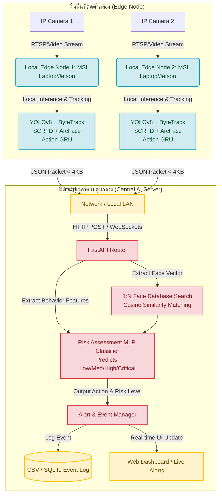
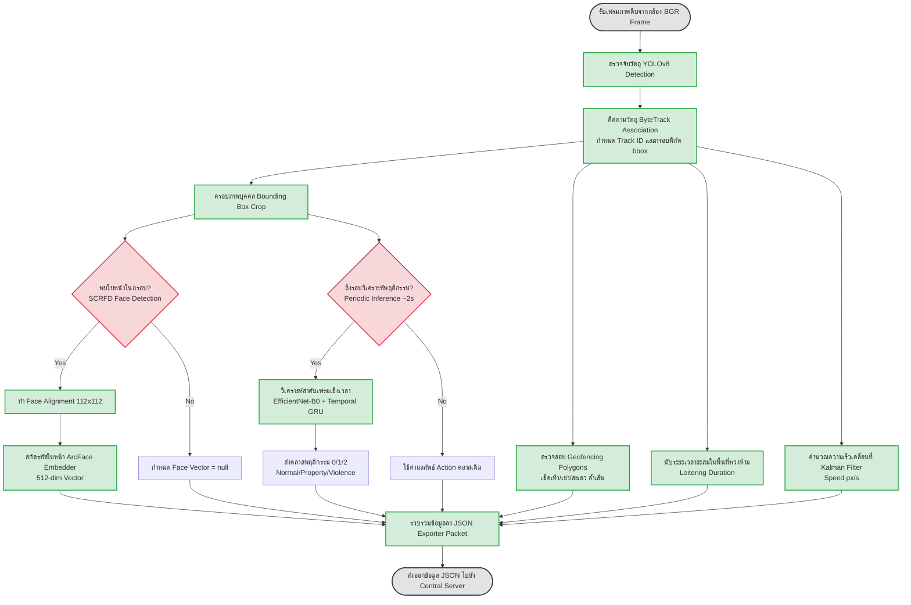

# ไดอะแกรมสรุปโครงสร้างโครงการ (Project Diagrams)
**โครงงาน:** ระบบเฝ้าระวังพื้นที่อัจฉริยะโดยใช้ปัญญาประดิษฐ์ (AI-Based Smart Surveillance System)

คุณสามารถนำรหัส **Mermaid** ด้านล่างนี้ไปวางในโปรแกรมวาดไดอะแกรม เช่น [Mermaid Live Editor](https://mermaid.live/) หรือเปิดผ่านโปรแกรมที่รองรับเพื่อบันทึกเป็นไฟล์ภาพนำไปใส่ในสไลด์พรีเซนต์และเล่มรายงานได้ทันทีครับ

---

## 🗺️ 1. สถาปัตยกรรมภาพรวมระบบ (Overall System Architecture)
แสดงการทำงานแบบกระจายศูนย์ (Distributed Edge-Central System) ระหว่างจุดติดตั้งกล้อง (Edge Nodes) และเซิร์ฟเวอร์หลักส่วนกลาง (Central Server)



---

## 🔄 2. ลำดับการประมวลผลภายใน Edge Node (Edge Processing Pipeline)
แสดงวงจรการทำงาน (Pipeline) ของภาพวิดีโอสดในแต่ละเฟรม ตั้งแต่รับภาพดิบจากกล้อง จนถึงแพ็กส่งออกข้อมูลเป็น JSON



---

## 🧠 3. การประมวลผลข้อมูลส่วนกลางและการจัดการความเสี่ยง (Central Risk Assessment Flow)
แสดงขั้นตอนที่เซิร์ฟเวอร์ส่วนกลางวิเคราะห์ระดับความเสี่ยงด้วยโมเดล MLP และการคัดกรองบุคคล

```mermaid
flowchart TD
    classDef input fill:#cce5ff,stroke:#004085,stroke-width:2px;
    classDef model fill:#e83e8c,stroke:#b1105c,stroke-width:2px,color:white;
    classDef action fill:#d4edda,stroke:#28a745,stroke-width:2px;

    JSON[รับข้อมูล JSON จาก Edge Node] --> Parse[แกะข้อมูลและแบ่งฟีเจอร์พฤติกรรม]
    
    %% Face Verification Branch
    Parse --> FaceEmbed[เวกเตอร์ใบหน้า 512 มิติ]
    FaceEmbed --> Match{เปรียบเทียบในระบบ 1:N Search<br>Cosine Similarity >= Threshold?}
    Match -->|Yes| Auth[ระบุชื่อบุคคล<br>Authorized Status = 1]
    Match -->|No| Stranger[ระบุเป็นคนแปลกหน้า<br>Stranger Status = 0]
    
    %% Feature Construction for MLP
    Parse --> Behav[ฟีเจอร์พฤติกรรมและพื้นที่ควบคุม]
    
    %% Risk Classifier Input (6 Dimensions)
    Auth & Stranger --> Construct[สร้างเวกเตอร์พฤติกรรม 6 มิติ:<br>1. Geofence Breach<br>2. Off-hours Status<br>3. Loitering Duration<br>4. Moving Speed<br>5. Authorized Status<br>6. Action Class / Confidence]
    Behav --> Construct
    
    Construct --> MLP[โมเดลประเมินความเสี่ยง<br>Feed-forward MLP Classifier]
    
    MLP --> Classify{ทำนายระดับความเสี่ยง<br>Risk Level}
    
    Classify -->|LOW / MEDIUM| Log[บันทึกข้อมูลประวัติเหตุการณ์ปกติลงฐานข้อมูล]
    Classify -->|HIGH / CRITICAL| Alert[เรียกใช้ Alert Manager เพื่อเตือนภัยทันที]
    
    Alert --> Capture[จับภาพเฟรมหลักฐานฝั่ง Edge]
    Alert --> WebPush[ส่งการแจ้งเตือน Real-time บน Dashboard]
    Alert --> Line[ส่งข้อความแจ้งเตือนทาง External API (Line/Telegram)]
    Alert --> CSV[บันทึกข้อมูลความเสียหายลง Event Log CSV]

    class JSON,FaceEmbed,Behav,Construct input;
    class MLP model;
    class Log,Alert,Capture,WebPush,Line,CSV action;
```
